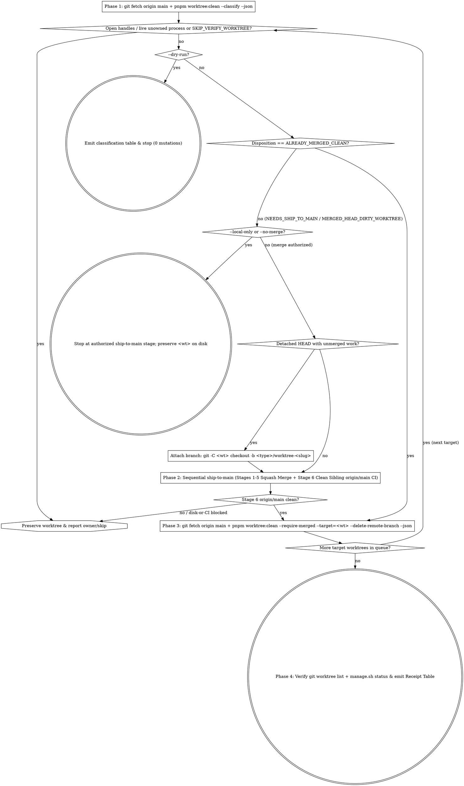

# Merge Secondary Worktrees to `main` & Delete Them (`clean-worktree` / `cleanWorkTree`)

This bundle is adapted for Inailso only. Before activation in another project,
adapt its commands, CI, custody and merge-proof contracts. Resolve
`docs/min-delivery.md` from the active Git root (`git rev-parse --show-toplevel`)
and require that guide plus every referenced project script before execution.
The [original Inailso guide](https://github.com/quan25211ot0433/monorepoInailsokit/blob/main/docs/min-delivery.md)
is reference only and does not supply the active project's authority.
Read the [active project contract](../ship-to-main/references/project-contract.md) first.

Before any checkout removal, run from the active Git root:
`python3 .agents/skills/min-delivery/scripts/worktree-preflight.py --worktree "<wt-path>"`.
Nonzero means preserve the target, including ignored state. Success is only a
read-only state check: separately require custody, exact task ownership, idle
processes, branch/merge proof and removal authority. Unknown ignored files block
removal. Classify owned disposable artifacts individually before any authorized
handling; broad ignore patterns and retained branches do not preserve file bytes.


Retire secondary Git worktrees without losing a single commit or dirty edit by classifying every worktree against `origin/main`, shipping unmerged or dirty worktrees sequentially through **`ship-to-main`**, and removing a worktree and its branch **only** when programmatic `--require-merged` verification proves containment in `origin/main`.

**Core principle:** `pnpm worktree:clean` without `--require-merged` is a local backup-and-prune utility, **never** a substitute for landing work on `origin/main`. Every unmerged commit or non-scratch edit in a target secondary worktree must complete **`ship-to-main` Phase 1 (Stages 1–5) AND Phase 2 (Stage 6)** before deletion, while the primary root checkout (`<primary-checkout>`) and protected branches (`main`, `master`, `HEAD`, `release/*`) remain untouched. Time urgency, disk pressure, or WIP backup refs never permit deleting an unmerged worktree directory. **Violating the letter of these rules is violating the spirit of these rules.**

## Authority & Completion Flags (`docs/min-delivery.md`)

- **`--dry-run`:** Run **Phase 1** read-only classification (`git fetch origin main` + `pnpm worktree:clean --classify --json`) and open-handle checks, print the per-worktree disposition plan, and stop with zero mutations.
- **`--local-only`:** Execute `ship-to-main` `--local-only` (Stages 1–2 locally; no remote fetch, push, PR, merge, or Stage 6). **Never delete** any worktree or directory under `--local-only` (not even via raw `git worktree remove`).
- **`--no-merge` (or merge unauthorized):** Execute `ship-to-main` `--no-merge` (Stages 1–4 open PR with green PR CI on `HEAD_SHA`) for unmerged targets, stop after Stage 4, and **preserve `<wt-path>` on disk** for PR review/iteration — **never** run directory-only `git worktree remove` on an open-PR or unmerged worktree even if asked to clean up the directory once PR CI turns green; report the `--no-merge` preservation boundary explicitly. Only targets already classified `ALREADY_MERGED_CLEAN` against `origin/main` may be deleted via `--require-merged`.
- **Authorized merge (default `/clean-worktree` when asked to merge worktrees to `main` and delete them):** Execute **Phases 1 → 4** sequentially. Never bypass `pnpm worktree:clean --classify --json` -> `ship-to-main` Stages 1–6 -> `--require-merged` under time or disk-full pressure.



## Phase 1: Preflight, Process Check & Worktree Classification

1. **Environment & Primary Root Protection:**
   - Use the active project `.nvmrc` Node version and `package.json` package manager; verify both before running gates.
   - **Never** run `git checkout`, `git pull`, `git reset`, or `git clean` in the primary root checkout (`<primary-checkout>`).
2. **Refresh `origin/main` & Classify Targets:**
   - Unless `--local-only` is active, run `git fetch origin main`.
   - Always run `pnpm worktree:clean --classify --json` (add `--target="<wt>"` when cleaning specific worktrees).
   - Inspect each target's returned `disposition`:
     - `SKIP_VERIFY_WORKTREE`: Active `ship-to-main` Stage 6 sibling worktree (`<owned-sibling-verification-path>`) — skip while Stage 6 owns it.
     - `ALREADY_MERGED_CLEAN`: Working tree is clean and `HEAD` is `MERGED_ANCESTOR` or `MERGED_SQUASH` in `origin/main` — queue directly for **Phase 3**.
     - `MERGED_HEAD_DIRTY_WORKTREE`: `HEAD` is already merged, but uncommitted/untracked files exist — inventory every ignored and untracked path, preserve unknown or foreign state, classify only exact owned disposable paths for authorized handling, and re-run `pnpm worktree:clean --classify --target="<wt>" --json`. If real product/doc edits remain, treat as `NEEDS_SHIP_TO_MAIN`.
     - `NEEDS_SHIP_TO_MAIN`: Contains unmerged commits (`UNMERGED` or `SUPERSEDED_UNVERIFIED`) and/or real uncommitted changes.
3. **Open-Handle & Live-Process Check:**
   - Before mutating or removing `<wt-path>`, check `lsof +D "<wt-path>" 2>/dev/null || true` and running command lines (`ps aux | grep -F "<wt-path>"`).
   - Stop only clearly owned stale dev/test watchers via `SIGTERM`; if another active agent, IDE, or user terminal owns `<wt-path>`, **preserve `<wt-path>` and ask the user**.

## Phase 2: Sequential Merge to `main` via `ship-to-main`

For each `NEEDS_SHIP_TO_MAIN` worktree, execute **strictly sequentially** (complete Target `N` through Stage 6 and Phase 3 deletion before starting Target `N+1`):

1. **Attach a Branch When Detached `HEAD` Holds Unmerged Work:**
   - If `isDetached === true`, create a descriptive branch inside the worktree before shipping:
     ```bash
     git -C "<wt-path>" checkout -b "chore/worktree-<slug>"
     ```
2. **Execute Full Two-Phase Shipping (**REQUIRED SUB-SKILL:** `ship-to-main`):**
   - Run `ship-to-main` **Phase 1 (Stages 1–5):** Diff Audit & `origin/main` reconciliation (including committing real uncommitted edits cleanly with cause-aligned tests) → Whole-Diff Review → `pr-body-contract.cjs` PR → Persistent Self-Hosted Runner CI (`scripts/ci/self-hosted-runner/manage.sh status` showing `inailso-ci-linux` and `inailso-ci-mac` `online`) → Squash Merge (`gh pr merge --squash`).
   - Run `ship-to-main` **Phase 2 (Stage 6):** Fetch `origin/main` into the recorded fresh owned sibling verification path, run `pnpm -C "$VERIFY_WT" install --frozen-lockfile`, execute touched local contract/workspace gates + dispatched `--ref main` GitHub CI across `$BASE_MAIN_SHA..$MAIN_SHA`, and ship any required `fix/post-merge-...` PR within the recurrence cap.
   - **Blocker & Disk-Pressure Rule:** If `ship-to-main` stops on a conflict, runner-authority prerequisite, insufficient disk space during Stage 6 `pnpm -C "$VERIFY_WT" install --frozen-lockfile`, Stage 6 recurrence cap, or `--no-merge`/`--local-only` stop boundary, **stop and preserve `<wt-path>` and its branch intact on disk** and record the blocker receipt — never pin WIP branches/backup refs and run raw `git worktree remove` on unmerged checkouts.

## Phase 3: Merge-Verified Worktree & Branch Deletion

Only after `<wt-path>` is `ALREADY_MERGED_CLEAN` (initially or following Phase 2 Stage 6 completion), always delete via `--require-merged` and `--delete-remote-branch` (never omit `--require-merged`, never run raw `git worktree remove` / `git branch -D`, and never run unleased `git push origin --delete <branch>`):

```bash
python3 .agents/skills/min-delivery/scripts/worktree-preflight.py --worktree "<wt-path>"
# Stop and preserve on nonzero; separately verify ownership, idle processes and merge authority.
git fetch origin main
pnpm worktree:clean --require-merged --target="<wt-path>" --delete-remote-branch --json
```

- `--require-merged` fails closed with exit code `5` (`UNMERGED_WORKTREE`) if `<wt-path>` is dirty, `UNMERGED`, or `SUPERSEDED_UNVERIFIED` (PR title mention without merge proof).
- On exit `0`, it records a local `refs/cleanworktree-backups/<branch>-<timestamp>` safety ref, unlocks and removes `<wt-path>`, prunes worktree metadata, deletes the local branch, and deletes `origin/<branch>` under a strict SHA `--force-with-lease`.

## Phase 4: Post-Cleanup Verification & Receipt Table

1. Run `git worktree list` to confirm `<primary-checkout>` remains intact and all deleted targets are absent (while any `--no-merge` / `--local-only` / blocked targets remain preserved).
2. Confirm `scripts/ci/self-hosted-runner/manage.sh status` still shows `inailso-ci-linux` and `inailso-ci-mac` `online` (never tear down persistent runners after cleanup).
3. Emit the mandatory receipt table:

| Worktree Path | Branch / Initial HEAD | Initial Disposition | PR `#` & Merge SHA (or Prior Proof) | Stage 6 `--ref main` Run ID | Deleted (WT / Local / Remote) | Backup Ref |
|---|---|---|---|---|---|---|
| `<path>` | `<branch>@<sha>` | `<ALREADY_MERGED_CLEAN \| NEEDS_SHIP_TO_MAIN \| BLOCKED>` | `<#PR -> MERGE_SHA or ancestor>` | `<MAIN_RUN_ID or prior-merged>` | `<yes/yes/yes or preserved (reason)>` | `<refs/cleanworktree-backups/...>` |

## Rationalization Prevention

| Excuse | Reality |
|---|---|
| "`pnpm worktree:clean` creates `refs/cleanworktree-backups/...` and commits WIP automatically, so I can run it directly without `--require-merged` or `ship-to-main`" | Unshipped commits buried in local `refs/cleanworktree-backups/*` are **not** on `origin/main`. Never delete an unmerged worktree; ship via `ship-to-main` first and always pass `--require-merged`. |
| "We only have 10 minutes and disk is almost full, so I'll pin WIP branches / backup refs and run raw `git worktree remove` to reclaim disk without `ship-to-main`" | Time or disk pressure never permits deleting unmerged worktree checkouts. Always run `pnpm worktree:clean --classify --json` -> sequential `ship-to-main` Stages 1–6 -> `--require-merged`; if disk space blocks Stage 6 `pnpm` install, stop and preserve unmerged worktrees intact. |
| "`gh pr merge --squash` succeeded and `gh run list --commit $MERGE_SHA --event push` returned `[]`, so I can delete the worktree now" | `.github/workflows` auto-trigger `push` on `release/**`, not `main`. `[]` means post-merge `main` is **unrun**. Complete `ship-to-main` **Stage 6** (`verify-origin-main` + local gates + `--ref main` CI) before Phase 3 deletion. |
| "Stage 6 passed, so I'll run `pnpm worktree:clean --in-flight=error --target=<wt>` and `git push origin --delete <branch>`" | Omitting `--require-merged` runs `git branch -D` without programmatic `origin/main` ancestry/squash-PR proof, and `git push origin --delete` lacks `--force-with-lease` SHA protection. Always run `pnpm worktree:clean --require-merged --target="<wt-path>" --delete-remote-branch --json`. |
| "The operator passed `--no-merge` AND asked to clean up the workspace directory tonight once PR CI is green, so I'll run `git worktree remove` while keeping the branch and open PR" | Under `--no-merge` (or `--local-only`), **never** remove an unmerged or open-PR worktree directory — not even via directory-only `git worktree remove`. Stop after `ship-to-main` Stage 4, preserve `<wt-path>` on disk for PR review/iteration, and report the `--no-merge` preservation boundary. |
| "A closed PR was mentioned in another merged PR's title (`SUPERSEDED_UNVERIFIED`), so I'll force-delete its worktree" | Title references do not prove commit/tree integration (`docs/ai-delivery-workflow.md`). Diff against `origin/main`; ship real remaining deltas or obtain explicit operator cancellation before non-merged removal. |
| "I'll ship and delete multiple worktrees in parallel to finish faster" | Persistent runners (`inailso-ci-linux`, `inailso-ci-mac`) and `origin/main` rebase/Stage 6 state serialize. Process one worktree completely through Stage 6 + Phase 3 deletion before starting the next. |

## Red Flags — STOP

- Pinning WIP branches/backup refs and running raw `git worktree remove` on unmerged worktrees under time or disk-full urgency instead of `pnpm worktree:clean --classify --json` -> sequential `ship-to-main` Stages 1–6 -> `--require-merged`
- Running `pnpm worktree:clean` / `node scripts/clean-worktree.mjs` **without** `--require-merged` (including `--in-flight=error` or `--in-flight=discard`), raw `git branch -D`, or unleased `git push origin --delete <branch>` instead of `--require-merged ... --delete-remote-branch`
- Deleting a worktree after Stage 5 squash-merge before `ship-to-main` **Stage 6** clean sibling `origin/main` verification and `--ref main` CI succeed
- Removing an open-PR or unmerged worktree directory (even via directory-only `git worktree remove` while keeping the branch) when `--no-merge` or `--local-only` is active
- Mutating, pulling, resetting, or cleaning the primary root checkout (`<primary-checkout>`) or tearing down `inailso-ci-linux` / `inailso-ci-mac`
- Deleting a worktree with active unowned `lsof` handles or live editor/agent processes without operator confirmation

## Installation compatibility check

`pnpm worktree:clean --install-skill` is check-only: it validates the canonical
`.agents/skills/clean-worktree` bundle against `.agents/project-skills.json`.
It must fail on missing, drifted, symlinked or pending installation state without
copying a catalog or creating `.claude` wrappers. Use the pinned source checkout's
`python3 scripts/project-install.py --source SOURCE --project PROJECT --revision SHA --check`
for diagnosis; reviewed adoption/update uses that installer's explicit `--apply`
with its required backup and preimage inputs. This interface grants no cleanup
or publication authority.
