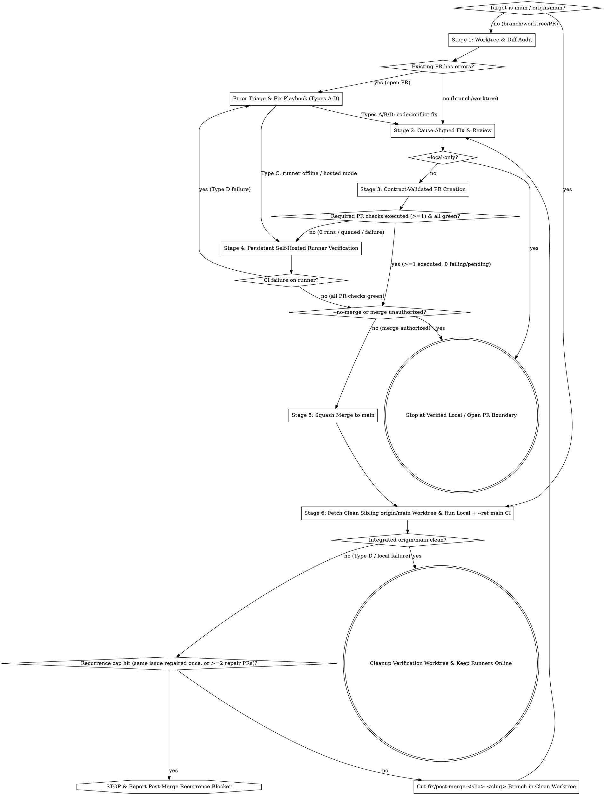

# Ship Branch, Worktree, or PR to `main` (`ship-to-main`)

This bundle is adapted for Inailso only. Before activation in another project,
adapt its commands, CI, custody and merge-proof contracts. Resolve
`docs/min-delivery.md` from the active Git root (`git rev-parse --show-toplevel`)
and require that guide plus every referenced project script before execution.
The [original Inailso guide](https://github.com/quan25211ot0433/monorepoInailsokit/blob/main/docs/min-delivery.md)
is reference only and does not supply the active project's authority.
Read the [active project contract](references/project-contract.md) first.

Before any checkout removal, run from the active Git root:
`python3 .agents/skills/min-delivery/scripts/worktree-preflight.py --worktree "<wt-path>"`.
Nonzero means preserve the target, including ignored state. Success is only a
read-only state check: separately require custody, exact task ownership, idle
processes, branch/merge proof and removal authority. Unknown ignored files block
removal. Classify owned disposable artifacts individually before any authorized
handling; broad ignore patterns and retained branches do not preserve file bytes.


Execute a two-phase shipping lifecycle within the active session's authorized publication boundary (`docs/min-delivery.md`):
1. **Phase 1 (Stages 1–5):** Take any branch, worktree, or open pull request from unverified/failing state to a clean squash-merge on `origin/main` with verified source-CI on the persistent self-hosted runners (`inailso-ci-linux` and `inailso-ci-mac`). *(If invoked directly with `main` or `origin/main` to audit/stabilize post-merge `main`, skip Phase 1 and enter directly at **Phase 2 / Stage 6**.)*
2. **Phase 2 (Stage 6):** Fetch `origin/main` into an isolated clean sibling worktree outside the primary checkout, install dependencies (`pnpm install --frozen-lockfile`), run post-merge local gates plus dispatched `--ref main` GitHub CI across the full merged range (`$BASE_MAIN_SHA..$MAIN_SHA`), and—if integrated `origin/main` has any issues or errors—fix them on a follow-up branch and push/ship via contract-validated PR.

**Core principle:** Never merge or declare completion past red or **unrun (`0` runs)** checks (`0` runs means **unverified**, never green), never mutate a dirty primary checkout or push directly to unprotected `main`, keep persistent `inailso-ci-linux` (Lima VM) and `inailso-ci-mac` (`ghrunner` LaunchAgent) online in `CI_RUNNER_MODE=self-hosted`, and adhere to the unified retry policy (up to two cause-aligned repairs per distinct issue, followed by read-only advice, followed by at most one final repair, then stop).

**Violating the letter of these rules is violating the spirit of these rules.**

## Publication & Runner Authority Boundaries

All operations adhere to the five-rung monotonic authority ladder defined in `docs/min-delivery.md`:
`local-edit < commit < push+PR < merge < deploy`.
Lower tiers cannot authorize higher tiers; each step requires explicit authorization.

Honor narrow session completion flags and authority limits from `docs/min-delivery.md` before advancing stages:
- **`--local-only`:** Execute **Stages 1–2** locally (and local commit only if authorized); **stop before Stage 3** (no remote fetch reconciliation when forbidden, no push, no PR, no merge, no Stage 6). Takes precedence over `--no-merge`.
- **`--no-merge` (or audit/fix/verify without merge authorization):** Execute **Stages 1–4** (commit, push, PR creation/update, and green PR CI on `HEAD_SHA`); **stop after Stage 4**, leaving the PR open and unmerged (skip Stages 5–6).
- **Authorized merge (default `/ship-to-main` invocation with merge authority):** Complete **Phase 1 (Stages 1–5)** AND **Phase 2 (Stage 6)**.
- **Runner administration authority:** Inspecting `manage.sh status` is read-only. Mutating runner state (`manage.sh start`, `manage.sh up --approve-register`, `manage.sh mac-up --approve-register`, `manage.sh mode self-hosted|hosted`, `manage.sh down --approve-destroy`) requires authorized runner administration; if missing or unauthorized, report the exact prerequisite instead of mutating runners.



## Prompt Quick Reference

```text
# 1. Single worktree or branch -> Phase 1 (ship PR to main) + Phase 2 (fetch clean origin/main, verify, fix & push follow-up PR if needed):
/ship-to-main <linked-worktree>

# 2. Existing open PR -> diagnose failing checks/comments/conflicts, ship to main, then verify & stabilize fetched origin/main:
/ship-to-main 28

# 3. Post-merge origin/main audit & stabilization -> enter directly at Phase 2 (Stage 6):
/ship-to-main origin/main

# 4. Multiple worktrees/branches -> sequential queue (complete Phase 1 + Phase 2 for target N before starting target N+1):
/ship-to-main <worktree-1> <worktree-2>
```

---

## Phase 1: Ship Target to `main` (Stages 1–5)

### Stage 1: Worktree & Diff Audit

1. **Resolve Target & Environment:**
   - Use the Node version pinned by the active project `.nvmrc` and the package manager pinned by `package.json`; verify versions before running gates.
   - If target is `main` or `origin/main`, compute `BASE_MAIN_SHA` from the last verified `main` SHA via `gh run list --branch main --status success` (falling back to `${MAIN_SHA}~1`) after `git fetch origin main` and jump directly to **Phase 2 (Stage 6)**.
   - If invoked with a `<pr-number>`, resolve its branch, head SHA, merge state, and local worktree:
     ```bash
     gh pr view "$PR_NUMBER" --json state,mergeable,mergeStateStatus,reviewDecision,headRefName,headRefOid,statusCheckRollup
     git worktree list
     ```
     If no local worktree is checked out on `headRefName`, create or reuse an isolated worktree (**REQUIRED SUB-SKILL:** `superpowers:using-git-worktrees`).
   - Verify active worktree custody before mutating or shipping the target worktree (claim custody if unclaimed, reclaim dead-PID custody, or coordinate handoff if owned by another active Codex/Antigravity session; never ship from the read-only primary checkout):
     ```bash
     node scripts/delivery/worktree-custody.mjs check --worktree <path>
     ```
   - Inspect `git status --short --branch` and `git diff origin/main...HEAD --stat`.
   - Inventory untracked and ignored artifacts before staging. Preserve unknown or foreign files, including custody records; classify exact task-owned disposable paths before authorized handling. Do not remove directories by a broad scratch pattern.
2. **Reconcile with `origin/main` (skip under `--local-only`):**
   - `git fetch origin main` and verify the branch cleanly merges or rebases onto `origin/main`. Stop and ask the user if semantic/product conflicts arise.
3. **GitNexus & Workspace Pre-Flight:**
   - Run `node .gitnexus/run.cjs status --json` and `node .gitnexus/run.cjs impact "<changed-symbol>" --direction upstream --repo .` for modified symbols. Warn the user on `HIGH`/`CRITICAL` risk.
   - Preview affected workspace tasks before running:
     ```bash
     pnpm verify:workspaces --workspace <manifest-name> --task test --task typecheck --dry-run
     ```

### Error Triage & Fix Playbook (Open PRs & Post-Merge `origin/main`)

When fixing an existing open PR, a Stage 4 check failure, or a Stage 6 post-merge `origin/main` failure, classify every blocker into **Types A–D** before touching code:

| Error Type | Symptom / Detection | Required Action |
|---|---|---|
| **Type A: Merge Conflict / Behind `main`** | `mergeable: "CONFLICTING"` or `mergeStateStatus: "BEHIND"` / `"DIRTY"` | Fetch `origin/main`, merge/rebase in the PR worktree, resolve mechanical conflicts (ask user on semantic conflicts), then run **Stage 2**. |
| **Type B: Review Comments / `CHANGES_REQUESTED`** | `gh pr view <PR> --json reviews,comments` | Evaluate each comment with **REQUIRED SUB-SKILL:** `superpowers:receiving-code-review`. Fix actionable Critical/Important items in **Stage 2** using TDD (`RED -> GREEN`). |
| **Type C: Runner Offline or Hosted Billing Block** | Jobs stay `queued`, or hosted fallback jobs fail in 3–5s with `steps: []`, `runner_name: ""`, and billing annotation (`"recent account payments have failed or your spending limit needs to be increased"`) | **Do NOT edit code.** Check `manage.sh status`; within authorized runner administration start `inailso-ci-linux` (`manage.sh start`) or set `manage.sh mode self-hosted`, then rerun/re-dispatch the workflows (**Stage 4** / **Stage 6**). |
| **Type D: Real CI or Local Gate Failure** | CI job executed steps (`steps != []`) and exited non-zero (`gh run view <run-id> --job <job-id> --log-failed`), or Stage 6 local gate failed on clean `origin/main` | Map the failing job/gate to its local reproduction lane below, diagnose root cause (**REQUIRED SUB-SKILL:** `superpowers:systematic-debugging`), and fix with TDD (**REQUIRED SUB-SKILL:** `superpowers:test-driven-development`) in **Stage 2** (via a `fix/post-merge-...` branch when discovered in **Stage 6**). |

#### Type D Failure → Local Reproduction & Workflow Map

1. **Documentation / Plan / Manifest / OpenAPI Drift (`docs-contract-gate.yml`, `workflow-lint.yml`, `docs-retention-audit.yml`):**
   - Reproduce locally: `pnpm docs:verify`, `pnpm domain:check`, `pnpm contracts:openapi`, `node scripts/validate-plans.mjs plans/active`, `node scripts/validate-local-release-roadmap.mjs`, `pnpm ci:workflows:lint`.
2. **Tier Boundary / Package Isolation / Exports (`tier-boundary-gate.yml`):**
   - Reproduce locally: `pnpm admission:check`, `pnpm check:package-cycles && pnpm check:boundaries && pnpm check:exports`, `pnpm tenant-boundaries:check`, `pnpm audit-mutations:check`, `pnpm audit-mutations:admission`, `pnpm service-ownership:check`, and `pnpm verify:workspaces --workspace <pkg> --task build --task typecheck --task test`.
3. **Backend Unit, Integration, Service E2E, or Contracts (`backend-e2e.yml`, `webbuilder-backend-gates.yml`):**
   - Reproduce locally: `pnpm verify:workspaces --workspace backend --task test --task typecheck --task lint` and `pnpm dev:tui test run --suite backend-test-int --json`.
4. **J5 Deterministic / Mobile A11y / POS Maestro / Payment PG (`j5-deterministic.yml`, `mobile-a11y.yml`, `inailsopos-maestro.yml` on `inailso-ci-mac`, `payment` smoke/PG):**
   - Reproduce locally: `pnpm test:j5:deterministic`, `pnpm check:maestro-syntax` (plus Maestro lane on `inailso-ci-mac` when `apps/InailsoPos` flows change), or `pnpm --filter payment test:pg <spec-path>`.
5. **Web / Admin Critical & Visual Gates (`admin-e2e-critical.yml`, `webbooking-e2e-critical.yml`, `shop-site-visual.yml`, `admin-uiux-gates.yml`):**
   - Reproduce locally via affected web mock/live E2E lanes in `docs/min-delivery.md`. On Lima `aarch64` container image-platform failures before test steps, diagnose container platform mismatch separately from product code; keep `CI_RUNNER_MODE=self-hosted` and do not weaken product tests.

#### Canceling Obsolete Runs After a Code Fix

Each persistent runner (`inailso-ci-linux` and `inailso-ci-mac`) runs one job at a time and cleans up between jobs via runner hooks (`docs/deployment/self-hosted-ci-runner.md` (active project)). Whenever a Type A, B, or D fix produces a new commit:

1. Cancel any owned obsolete queued/in-progress workflow runs on the old SHA so the persistent runner slot is freed immediately:
   ```bash
   gh run cancel <obsolete-run-id>
   ```
2. Commit, push the new `HEAD_SHA`, and update the PR body (**Stage 2 & Stage 3**).
3. Verify the newly triggered or dispatched workflows on `inailso-ci-linux` / `inailso-ci-mac` (**Stage 4**). Never deregister or destroy the persistent runners between commits.

### Stage 2: Cause-Aligned Fix & Review

1. **Scoped & Integration Verification (`docs/min-delivery.md` (active project)):**
   - Run affected workspace `test`, `typecheck`, `lint`, and `build` lanes via `pnpm verify:workspaces`.
   - When `packages/*` imports/exports change: `pnpm check:package-cycles && pnpm check:boundaries && pnpm check:exports`.
   - When docs/plans/manifests change: `pnpm docs:verify && pnpm domain:check`.
   - When `apps/backend`, `apps/payment`, or `apps/subscription` persistence changes: run real PostgreSQL integration suites (`pnpm dev:tui test run --suite backend-test-int --json`, `pnpm --filter <payment|subscription> test:pg`).
2. **Root-Cause & TDD Repair Loop:**
   - For any failing test or audit defect: **REQUIRED SUB-SKILLS:** `superpowers:systematic-debugging` (prove root cause first) and `superpowers:test-driven-development` (write failing test `RED` → minimal fix `GREEN` → re-verify).
   - **REQUIRED SUB-SKILL:** `superpowers:requesting-code-review` over `origin/main..HEAD` (resolve Critical/Important findings via `superpowers:receiving-code-review`).
3. **Pre-Commit Gate:**
   - **REQUIRED SUB-SKILL:** `superpowers:verification-before-completion`.
   - Run `node .gitnexus/run.cjs detect-changes --scope all --repo .` and commit atomic conventional commits without AI attribution.
   - *(If `--local-only` is active, stop here and report local evidence.)*

### Stage 3: Contract-Validated PR Creation

1. **Author & Validate PR Body:**
   - Include all required sections enforced by `scripts/ci/pr-body-contract.cjs`: `## End-to-end work summary`, `## Subagent delegation`, `## Technical decisions`, `## Deviations from plan`, `## Completion evidence`, `## Checklist`, `## Human actions required`, `## Linked Issues`, and `## Ship Mode`.
   - Validate before creating or editing the PR:
     ```bash
     node scripts/ci/pr-body-contract.cjs --file <pr-body-file.md>
     ```
2. **Push & Open/Update PR:**
   - `git push -u origin <branch>` (never `--force` unless explicitly instructed; never push directly to `main`).
   - `gh pr create --base main --head <branch> --title "<type>: <summary>" --body-file <pr-body-file.md>` (or `gh pr edit <PR> --body-file <pr-body-file.md>`).

### Stage 4: Persistent Self-Hosted Runner Verification

Inspect `gh pr checks <PR>` and follow `docs/deployment/self-hosted-ci-runner-usage.md` (active project) and `docs/deployment/self-hosted-ci-runner.md` (active project):

1. **Check Persistent Runner Status:**
   ```bash
   scripts/ci/self-hosted-runner/manage.sh status
   ```
   - Expect `CI_RUNNER_MODE=self-hosted` (or `<absent> (self-hosted by default)`), `lima inailso-ci-linux: Running`, and `inailso-ci-linux` (`self-hosted,Linux,ARM64,inailso-linux`) + `inailso-ci-mac` (`self-hosted,macOS,ARM64,inailso-mac`) `online`.
   - Within authorized runner administration (if unauthorized, report the prerequisite and stop before mutating runners):
     - **If the Mac slept or `inailso-ci-linux` is `Stopped`:** `scripts/ci/self-hosted-runner/manage.sh start && scripts/ci/self-hosted-runner/manage.sh status`
     - **If first-time setup (`absent`, requires explicit operator approval):** `scripts/ci/self-hosted-runner/manage.sh up --approve-register` and `scripts/ci/self-hosted-runner/manage.sh mac-up --approve-register`
     - **If `CI_RUNNER_MODE=hosted` caused a hosted billing failure (`Type C`):** `scripts/ci/self-hosted-runner/manage.sh mode self-hosted` then `gh run rerun <failed-run-id>` *(cancel any owned obsolete queued run first so labels re-evaluate to `inailso-linux` / `inailso-mac`)*.
2. **Verify PR CI Execution on `main` Pull Requests:**
   - Source-CI workflows in `.github/workflows/*.yml` auto-trigger `pull_request` on `[main, release, 'release/**']`. Verify that required PR checks execute automatically on `$HEAD_SHA`.
   - If an un-triggered gate workflow requires manual dispatch, trigger it via:
     ```bash
     gh workflow run <workflow.yml> --ref "<branch>"
     ```
3. **Watch Required PR Workflows to Completion:**
   ```bash
   gh pr checks "$PR_NUMBER" --watch
   ```
   *(Each persistent runner executes one job at a time serially; a busy runner is normal.)*
4. **If Any Check Fails on `inailso-ci-linux` or `inailso-ci-mac`:**
   - Do **not** switch `manage.sh mode hosted` to hide a product failure.
   - Follow **Error Triage & Fix Playbook (Type D)** and **Canceling Obsolete Runs After a Code Fix** above.
   - *(If `--no-merge` is active or merge is not authorized, stop once all required PR checks on `HEAD_SHA` pass and report the open PR + CI run IDs.)*

### Stage 5: Squash Merge to `main` (Mandatory Handoff to Stage 6)

1. **Merge Gate:**
   - Confirm `>= 1` required source-CI workflow executed on `HEAD_SHA` with `0 failing` and `0 pending`, and `gh pr view <PR> --json state,mergeable,mergeStateStatus` reports `OPEN` + `MERGEABLE`.
   - Update PR body with the passing CI run IDs (`gh pr edit <PR> --body-file <pr-body-file.md>`).
   - Squash-merge to `main` and record `BASE_MAIN_SHA` (on the initial target merge; preserve `BASE_MAIN_SHA` across any Stage 6 post-merge repair PRs for the same target):
     ```bash
     gh pr merge "$PR_NUMBER" --squash
     MERGE_SHA="$(gh pr view "$PR_NUMBER" --json mergeCommit --jq .mergeCommit.oid)"
     if [ -z "$BASE_MAIN_SHA" ]; then
       LAST_VERIFIED_MAIN_SHA="$(gh run list --branch main --status success --limit 20 --json headSha --jq '.[0].headSha // empty' 2>/dev/null || true)"
       if [ -n "$LAST_VERIFIED_MAIN_SHA" ] && git merge-base --is-ancestor "$LAST_VERIFIED_MAIN_SHA" "$MERGE_SHA" && [ "$LAST_VERIFIED_MAIN_SHA" != "$MERGE_SHA" ]; then
         BASE_MAIN_SHA="$LAST_VERIFIED_MAIN_SHA"
       else
         BASE_MAIN_SHA="${MERGE_SHA}~1"
       fi
     fi
     ```
2. **Check Any Auto-Triggered `--event push` Runs (Never Treat `[]` as Completion):**
   ```bash
   gh run list --commit "$MERGE_SHA" --event push --limit 20 --json databaseId,name,status,conclusion,url
   ```
   - If `--event push` runs exist, watch each to `success` (`gh run watch <push-run-id> --exit-status`).
   - **CRITICAL:** An empty `[]` result from `--event push` does **NOT** verify post-merge `main` (`push` triggers in `.github/workflows` target `release` / `release/**`). **Always proceed immediately to Stage 6** before declaring the PR shipped or starting the next queued target.
3. **Close Merged Worktree & Plan Provenance:**
   - Capture `BRANCH_HEAD_SHA="$(git -C <worktree> rev-parse HEAD)"` (or `gh pr view "$PR_NUMBER" --json headRefOid --jq .headRefOid`) before teardown, fetch `origin/main` so local `origin/main` contains `$MERGE_SHA`, run `python3 .agents/skills/min-delivery/scripts/worktree-preflight.py --worktree "<worktree>"` and preserve on refusal, then after ownership/process/merge gates pass run the provenance-verified closer from outside `<worktree>` to release `.worktree-owner.json`, remove the merged feature worktree, and delete the merged local branch ref:
     ```bash
     BRANCH_HEAD_SHA="$(git -C <worktree> rev-parse HEAD)"
     git fetch origin main
     # Combined teardown (+ optional immediate plan stamp when a separate clean --target-worktree already exists):
     node scripts/delivery/close-merged-plan.mjs --branch <branch> --worktree <worktree> [--plan <plan-path> --target-worktree <clean-linked-worktree>]
     # Or, if stamping an active plan in a separate deferred step after local refs/heads/<branch> was deleted above, pass --head-sha:
     node scripts/delivery/close-merged-plan.mjs --branch <branch> --head-sha "$BRANCH_HEAD_SHA" --plan <plan-path> --target-worktree <clean-linked-worktree>
     ```

---

## Phase 2: Post-Merge `origin/main` Fetch, Verify, Fix & Push Loop (Stage 6)

After **every** Stage 5 merge (or when invoked directly on `main` / `origin/main`), fetch the live `origin/main` source code into a clean sibling worktree, verify integrated `origin/main`, and remediate any post-merge issues via a contract-validated follow-up PR:

### 1. Fetch & Prepare Isolated Clean Sibling `origin/main` Worktree

- Refresh `origin/main` and assert `$MERGE_SHA` (or `$MAIN_SHA` on direct `origin/main` entry) is an ancestor of `origin/main`:
  ```bash
  git fetch origin main
  MAIN_SHA="$(git rev-parse origin/main)"
  if [ -z "$BASE_MAIN_SHA" ]; then
    LAST_VERIFIED_MAIN_SHA="$(gh run list --branch main --status success --limit 20 --json headSha --jq '.[0].headSha // empty' 2>/dev/null || true)"
    if [ -n "$LAST_VERIFIED_MAIN_SHA" ] && git merge-base --is-ancestor "$LAST_VERIFIED_MAIN_SHA" "$MAIN_SHA" && [ "$LAST_VERIFIED_MAIN_SHA" != "$MAIN_SHA" ]; then
      BASE_MAIN_SHA="$LAST_VERIFIED_MAIN_SHA"
    else
      BASE_MAIN_SHA="${MAIN_SHA}~1"
    fi
  fi
  git merge-base --is-ancestor "${MERGE_SHA:-$MAIN_SHA}" "$MAIN_SHA"
  ```
- **Track 1 Docs-Only Streamlining:** If the merged change is a Track 1 documentation-only change (modifying only `docs/**`, `*.md`), skip creating the clean sibling worktree, skip `pnpm install`, and skip remote `--ref main` CI dispatch. Verify post-merge documentation contracts directly via `pnpm docs:verify` locally.
- **REQUIRED SUB-SKILL:** `superpowers:using-git-worktrees` — choose one explicit,
  owned sibling path outside the primary checkout, recorded in the ledger. An
  existing path is preserved and reported; never reset it or select incrementing
  paths to bypass a conflict. Reuse requires exact ownership, idle processes,
  a passing preflight and HEAD already equal to the required revision. Otherwise
  create a fresh owned path only after resolving the conflict:
  ```bash
  : "${VERIFY_WT:?set the recorded owned sibling path}"
  if [ -e "$VERIFY_WT" ] || [ -L "$VERIFY_WT" ]; then
    echo "Existing verification path preserved; verify ownership, state and HEAD before reuse" >&2
    exit 1
  fi
  git worktree add --detach "$VERIFY_WT" origin/main
  python3 .agents/skills/min-delivery/scripts/worktree-preflight.py --worktree "$VERIFY_WT"
  node scripts/delivery/worktree-custody.mjs claim --worktree "$VERIFY_WT" --runtime <runtime> --session <session> --track <track> --plan <plan-path>
  pnpm -C "$VERIFY_WT" install --frozen-lockfile
  ```
  *(If `"$BASE_MAIN_SHA..$MAIN_SHA"` touches `@repo/entity` or `apps/{backend,payment,subscription}/prisma/**`, also run the owning Prisma client generation / entity build inside `"$VERIFY_WT"` per `docs/min-delivery.md`.)*

### 2. Detect Issues on Integrated `origin/main` (Local Gates + Dispatched `--ref main` CI)

1. **Local Contract & Touched-Boundary Gates First (`docs/min-delivery.md`):**
   - Compute cumulative changed paths across the initial merge and any post-merge repair commits:
     ```bash
     git -C "$VERIFY_WT" diff "$BASE_MAIN_SHA..$MAIN_SHA" --name-only
     ```
   - Inside `"$VERIFY_WT"`, execute every contract gate triggered by those cumulative paths in `docs/min-delivery.md` (e.g. `pnpm docs:verify && pnpm domain:check`, `node scripts/validate-plans.mjs plans/active`, `pnpm check:package-cycles && pnpm check:boundaries && pnpm check:exports`, admission/tenant/audit-mutation/service-ownership checks, `pnpm contracts:openapi`) **plus** `pnpm verify:workspaces --workspace <manifest-name> --task test --task typecheck` (`--task lint` / `--task build` when declared) and required persistence/E2E lanes for touched workspaces.
2. **Dispatched GitHub CI on `--ref main`:**
   - Confirm `scripts/ci/self-hosted-runner/manage.sh status` reports `CI_RUNNER_MODE=self-hosted` (or absent default) with `inailso-ci-linux` (`Running`, `online`) and `inailso-ci-mac` (`online`).
   - Dispatch the matching `workflow_dispatch` gate workflow(s) covering `"$BASE_MAIN_SHA..$MAIN_SHA"` (from `.github/workflows/ci-release.yml` (active project), plus `inailsopos-maestro.yml` when `apps/InailsoPos` Maestro flows changed, or `ci-release.yml --ref main` when changes span multiple tiers), poll for the newly created run bound to `$MAIN_SHA`, and watch it to `success`:
     ```bash
     DISPATCHED_AT="$(date -u +%Y-%m-%dT%H:%M:%SZ)"
     gh workflow run <workflow.yml> --ref main
     MAIN_RUN_ID=""
     for _ in 1 2 3 4 5 6; do
       MAIN_RUN_ID="$(gh run list --workflow <workflow.yml> --branch main --event workflow_dispatch --limit 10 --json databaseId,headSha,createdAt --jq "[.[] | select(.headSha == \"$MAIN_SHA\" and .createdAt >= \"$DISPATCHED_AT\")][0].databaseId // empty")"
       [ -n "$MAIN_RUN_ID" ] && break
       sleep 5
     done
     test -n "$MAIN_RUN_ID"
     gh run watch "$MAIN_RUN_ID" --exit-status
     ```

### 3. Clean Exit vs. Fix & Push Follow-Up PR

- **If all local gates and dispatched `--ref main` CI runs succeed:**
  1. Run `python3 .agents/skills/min-delivery/scripts/worktree-preflight.py --worktree "$VERIFY_WT"`; preserve it on refusal. After separate custody, ownership, process and merge/authority checks pass, remove without force: `git worktree remove "$VERIFY_WT"`, then `git worktree prune`. Dependency caches and custody files are ignored state: preserve the checkout until their exact ownership and disposal are explicitly classified.
  2. Reset `unset BASE_MAIN_SHA` for the next target and confirm `scripts/ci/self-hosted-runner/manage.sh status` still shows `inailso-ci-linux` and `inailso-ci-mac` `online` (only run `manage.sh down --approve-destroy` / `manage.sh mac-down --approve-destroy` on explicit operator request).
  3. Shipping for this target is now complete; proceed to the next queued target or report final evidence.

- **If any local gate or `--ref main` CI job fails:**
  1. **Classify Blocker:** If `Type C` (runner offline / hosted billing failure with `steps: []`), recover runners via **Stage 4** (`manage.sh start` / `manage.sh mode self-hosted` within authorized runner administration) and re-dispatch `--ref main` without touching code.
  2. **Enforce Recurrence Cap (Max 1 Automatic Repair per Distinct Issue; Max 2 Total Post-Merge Repair PRs per Target):**
     - Check whether this session already merged an automatic post-merge repair PR for the **same** failing invariant/symptom, OR already merged **2** post-merge repair PRs for the current target.
     - If **yes**: **STOP immediately.** Do not open another automatic repair PR and do **not** push directly to `main`. Preserve `"$VERIFY_WT"` and report reproduction steps, exact error output, prior repair PR(s)/SHA(s), and required operator decision.
  3. **Cut Follow-Up Fix Branch, Fix with TDD, Push & Ship via PR (Stages 2–5 → Stage 6):**
     - Inside `"$VERIFY_WT"`, create a dedicated fix branch off `origin/main` (**never** commit on `main` or run `git push origin HEAD:main`, even though `main` has GitHub branch protection disabled):
       ```bash
       git -C "$VERIFY_WT" checkout -b "fix/post-merge-${MAIN_SHA:0:7}-<slug>" origin/main
       ```
     - Keep `BASE_MAIN_SHA` unchanged so re-entry verifies the full cumulative range.
     - Run **Stage 2** (`superpowers:systematic-debugging` → `superpowers:test-driven-development` RED/GREEN → `superpowers:requesting-code-review` → `superpowers:verification-before-completion` + `node .gitnexus/run.cjs detect-changes --scope all --repo .`), **Stage 3** (`node scripts/ci/pr-body-contract.cjs --file <pr-body-file.md>` + `git push -u origin <fix-branch>` + `gh pr create --base main`), **Stage 4** (persistent runner CI verification), and **Stage 5** (`gh pr merge --squash`), then re-enter **Stage 6** on the new `$MERGE_SHA` to prove integrated `origin/main` is clean.

---

## Rationalization Prevention

| Excuse | Reality |
|---|---|
| "`gh run list --commit $MERGE_SHA --event push` returned `[]` (0 failing runs) and `$MERGE_SHA` is on `origin/main`, so shipping is complete" | Source-CI workflows in `.github/workflows` auto-trigger `pull_request`/`push` on `release`/`release/**`, not `main`. An empty `[]` list means post-merge `main` is **unrun/unverified**, never green. Always complete **Stage 6** (clean sibling `origin/main` worktree + local gates + dispatched `--ref main` CI). |
| "Post-merge `origin/main` has a tiny 6-line fix and `main` has `protected: false` on GitHub, so I'll just `git push origin HEAD:main`" | Direct pushes to `main` bypass `pr-body-contract.cjs`, independent code review, and PR CI auditability. Always cut `fix/post-merge-<sha>-<slug>` in `"$VERIFY_WT"` and ship via **Stages 2–5** unless the operator explicitly instructs a direct `main` push. |
| "I'll run `git checkout main && git pull origin main` in `<primary-checkout>` (or create a worktree nested inside it without `pnpm install --frozen-lockfile`)" | Pulling into a dirty primary checkout risks clobbering uncommitted work, and nesting a worktree without `pnpm install --frozen-lockfile` leaks ancestor `node_modules`. Always use a clean sibling worktree outside the primary checkout and run `pnpm -C "$VERIFY_WT" install --frozen-lockfile`. |
| "`pnpm local:ci` or unit tests passed locally, so I can `gh pr merge` while GitHub checks are red or `0` checks ran" | Private repository settings may not block red or unrun merges at the API layer. Never merge until `>= 1` required GitHub workflow on `HEAD_SHA` executes and finishes `success` (dispatching `workflow_dispatch` on `--ref <branch>` in **Stage 4** when `gh pr checks` is empty). |
| "Checks are red on the PR or `--ref main`, so I'll start editing code right away" | Inspect job steps and annotations first (`check-runs/<id>/annotations`). Hosted billing blocks (`Type C`) have `steps: []` and need `manage.sh mode self-hosted` + `manage.sh start`, not code edits. |
| "My first `fix/post-merge-...` PR merged, and the same check still fails on `origin/main`—I'll try one more quick fix PR" | Recurrence cap is **1** automatic post-merge repair per distinct issue (and max **2** total post-merge repair PRs per target). If the same issue persists on the new `$MERGE_SHA`, STOP immediately and report evidence. |
| "Shipping is finished, so I should destroy the Lima VM with `manage.sh down --approve-destroy`" | `inailso-ci-linux` and `inailso-ci-mac` are **persistent** runners shared across PRs. Never tear them down without explicit operator instruction. |

## Red Flags — STOP

- Declaring a PR shipped after Stage 5 when `gh run list --commit "$MERGE_SHA" --event push` returned `[]` without executing **Stage 6**
- Merging a PR when `--no-merge` or `--local-only` is active, when merge is unauthorized, when `0` GitHub checks ran on `HEAD_SHA`, or while any required check is failing/pending
- Running `git push origin main` / `git push origin HEAD:main` directly to unprotected `main` instead of cutting `fix/post-merge-<sha>-<slug>` and opening a contract-validated PR
- Running `git checkout main` or `git pull origin main` inside a dirty primary workspace, or skipping `pnpm -C "$VERIFY_WT" install --frozen-lockfile` in the sibling verification worktree
- Diffing only `"$MAIN_SHA~1..$MAIN_SHA"` after a post-merge repair PR instead of preserving `"$BASE_MAIN_SHA..$MAIN_SHA"` across the entire target
- Opening a second automatic post-merge repair PR for the same recurring failure (or more than 2 post-merge repair PRs for one target)
- Mutating runner state (`manage.sh up`, `mac-up`, `mode`, `down`) without authorized runner administration, switching `manage.sh mode hosted` to bypass a product failure, or tearing down persistent runners after an ordinary merge
- Running `docker compose`, `scripts/local-compose.mjs`, or `pnpm ci:local` expecting them to satisfy GitHub status checks, or closing/reopening a PR to retrigger CI
